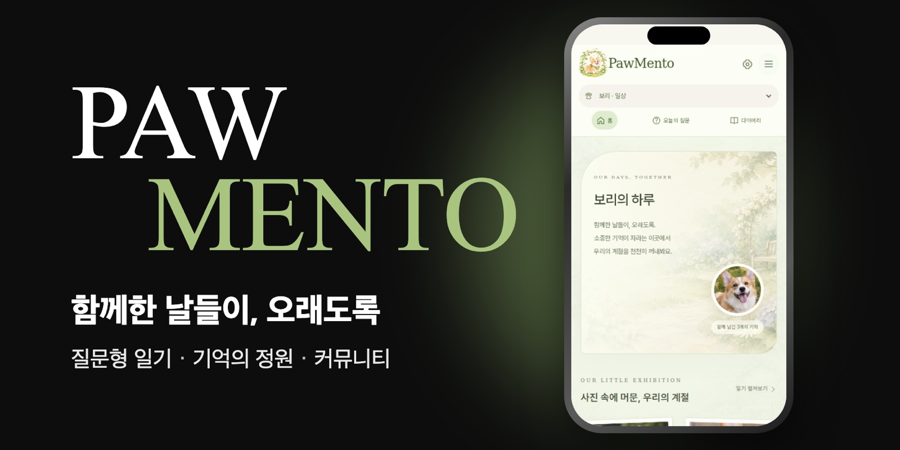

# 양덕관 (Deokkwan Yang)

**기술이 왜 등장했는지부터 이해하고 쓰는 백엔드 개발자**

 

## 요즘 하는 일

반려동물과의 평범한 오늘을 기록하고 오래 간직하도록 돕는 서비스 **[pawmento](#pawmento)** 를 만들고 있습니다.

 

## 프로젝트

### showmoa

공연 정보 플랫폼입니다. 흩어진 전국 공연 정보를 매일 모아 검색·지도·찜 캘린더로 보여 줍니다. (4인 팀, 2026.08 ~ 진행 중)

**역할**: CTO · 백엔드. 공연 데이터 수집·동기화, 실행 환경과 설정, 서버 배포·운영, 모니터링과 성능 측정

**고른 것과 버린 것**
- **전체 재검증 대신 요일별 1/7 재검증**: 매일 전부(약 3,500건)를 다시 조회하면 실행 시간 한도에 걸려 매번 같은 뒷부분이 빠집니다. 공연 ID 해시로 7조각에 고정 배정해 하루 5~6분으로 줄였습니다. 상태를 따로 저장할 필요도, 스키마를 바꿀 필요도 없습니다.
- **분산 락과 이미지 레지스트리는 도입하지 않음**: 앱 인스턴스가 하나라 락이 필요 없고, 서버에서 바로 빌드하는 쪽이 가장 단순했습니다. 대신 "빌드가 메모리에 부담이 되면 CI + GHCR로 옮긴다"는 전환 조건을 기록해 두었습니다.

**원인을 파고든 문제**
- **한도보다 적게 불렀는데 차단**: 공식 한도(초당 10회)보다 훨씬 적게 호출했는데도 150~300회마다 일시 차단됐습니다. 실제 동작을 관찰해 1·2·4·8·16분 간격으로 다시 시도하게 했습니다. 오류도 HTTP 200으로 오는 API라서 응답 본문의 결과 코드로 성공 여부를 판정합니다.
- **막 띄운 앱의 p95 604ms**: 요청이 한두 건뿐이면 p95가 곧 가장 느린 한 건이 되는데, 그 한 건이 캐시가 빈 첫 요청이었습니다. 반복 요청은 약 40ms였습니다. 그래서 성능은 요청이 충분히 쌓인 구간에서 판단하도록 대시보드 안내에 추가했습니다.

**결과**
- 개발 서버를 운영하고 있습니다. 매일 새벽 KOPIS 동기화(공연 약 5,000건, 극장 약 1,000곳), 실패하면 자동으로 되돌리는 배포 스크립트, 매일 백업과 복원 검증, 서버 밖에서 감시하는 장애 알림을 갖췄습니다.
- k6 성능 기준선(vCPU 2개, 메모리 4GB): 동시 사용자 10명에서 p95 약 200ms, 오류 0%, CPU 16%였습니다. 1명일 때와 비교해 p95가 거의 늘지 않았습니다.

`Java 21` `Spring Boot 4.1` `PostgreSQL + PostGIS` `Valkey` `Docker Compose` `Caddy` `k6`

[Backend 저장소](https://github.com/dawn-guys/showmoa-backend) · [Frontend 저장소](https://github.com/dawn-guys/showmoa-frontend)

 

### test-moa

소프트웨어 테스터 모집 플랫폼입니다. 개발자가 조건에 맞는 테스터를 모으고, 항목별 피드백을 받고, 크레딧으로 보상하는 서비스입니다. (5인 팀)

- **역할**: 실시간 채팅 전체(설계·백엔드·화면 연결), 프론트 공통 구조, 테스트 서버 배포
- **왜 SSE인가**: 메시지는 일반 POST로 보내고 서버는 "새 메시지·읽음" 알림만 보내면 돼서 WebSocket 대신 SSE를 골랐습니다. 일반 HTTP라 nginx → Next(BFF) → Spring 경로를 그대로 탈 수 있습니다.
- **일부러 하지 않은 것**: 채팅용 저장소를 따로 두지 않고 PostgreSQL에서 방 행 잠금과 방별 순번(`seq`)으로 순서·중복을 보장했습니다. Redis pub/sub은 서버가 한 대인 지금은 필요 없어 보류했습니다([#267](https://github.com/likelion-backendschool-9th/test-moa/issues/267)).
- **원인 추적**: CI에서만 채팅 테스트가 실패했습니다. 테스트 컨텍스트 11개 × 커넥션 풀 10개 = 110개가 PostgreSQL 한도 100을 넘은 것이 원인이었습니다. 테스트 서버에서 SSE가 안 온 것은 호스트 nginx의 버퍼링 때문이어서 SSE 경로에만 버퍼링 끔과 긴 read timeout을 따로 두었습니다.

`Java 21` `Spring Boot 4.1` `Spring Security` `JPA` `PostgreSQL` `Next.js` `Docker` `GitHub Actions`

[저장소](https://github.com/likelion-backendschool-9th/test-moa) · [테스트 서버](https://test-moa.newlecture.com)

 

### pawmento

반려동물의 사진·영상·음성·글을 한곳에 보관하고, 하루 한 질문으로 평범한 일상을 쉽게 기록하도록 돕는 PWA 기반 웹·모바일 서비스입니다. 보호자가 준비되었을 때 홈 화면을 함께하는 오늘(ACTIVE)에서 기억의 정원(GARDEN)으로 직접 전환할 수 있고, 커뮤니티에서 반려 생활·돌봄·장례·추모 경험을 나눌 수 있습니다.

<!-- TODO: 맡은 부분 -->
<!-- TODO: "왜" 문장 1~2개 -->

`Java 21` `Spring Boot` `PostgreSQL` `Testcontainers` `Next.js` `PWA` `Docker`

[저장소](https://github.com/likelion-backendschool-9th/pawmento)

 

## 기술 스택

**Backend** 

**Database** 

**Infra** 

**Test** 

**Frontend (협업)** 

