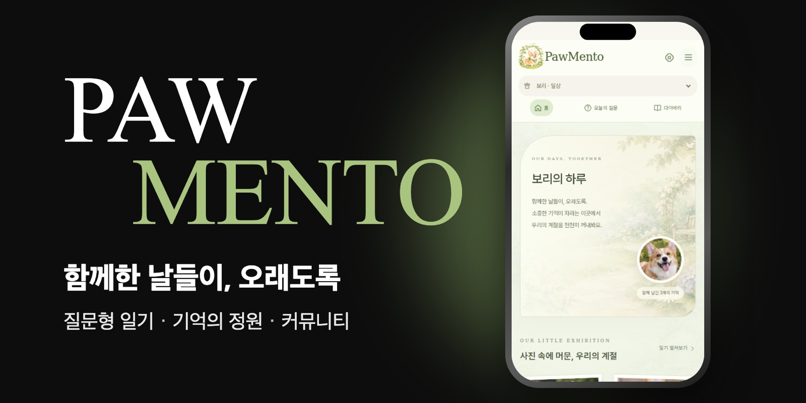

# Pawmento 설계 기록

반려동물의 사진·음성·글을 하루 한 질문으로 기록하는 PWA 서비스입니다. (5인 팀, 2026.11 ~ 진행 중)

**역할**: 인프라·배포 전체, CI와 팀 협업 규칙, 커뮤니티·AI 엽서 백엔드

## 고른 것과 버린 것

- **API 버전 접두사**: 컨트롤러마다 직접 쓰기, context-path, addPathPrefix, Spring 7의 API 버전 기능을 비교했습니다. context-path는 MockMvc 테스트에 적용되지 않아 테스트 경로와 실제 경로가 달라지는 함정이 있어서 addPathPrefix를 골랐습니다. Spring 7 기능은 v1과 v2를 함께 운영할 때 가치가 있어 보류했습니다.
- **예외 처리 규칙**: 기존 의존 규칙이 도메인 예외까지 막아서 "작성자만 수정할 수 있다" 같은 업무 규칙이 서비스로 밀려나 있었습니다. 도메인 예외를 하나씩 import하면 global과 도메인 사이에 순환 의존이 생기므로, 공통 부모 예외만 처리하는 방식을 팀 규칙으로 제안해 문서화했습니다.

## 원인을 파고든 문제

- **첫 배포의 no such host**: Secret에 내 PC에서만 통하는 SSH 별칭이 들어간 것이 원인이었습니다.
- **호스트 키 지문 형식**: 호스트 키 검증을 넣을 때 액션 내부의 Go 코드를 확인해, 지문 값에 `SHA256:` 접두사까지 넣어야 한다는 것을 알았습니다. 리뷰에서 제안된 형식대로 넣었다면 배포가 실패했을 것입니다.

## 결과

- develop에 머지하면 검사 → 이미지 빌드 → 공용 서버 배포 → 응답 확인까지 자동으로 진행되고, 이 상태로 운영 중입니다. 빌드는 GitHub Actions에서 하고 서버는 GHCR 이미지만 받아 공용 서버의 자원을 쓰지 않습니다.

## 기술

`Java 21` `Spring Boot` `PostgreSQL` `Testcontainers` `Next.js` `PWA` `Docker` `GitHub Actions` `GHCR`

## 링크

[저장소](https://github.com/likelion-backendschool-9th/pawmento) · [← 프로필로](../README.md)
