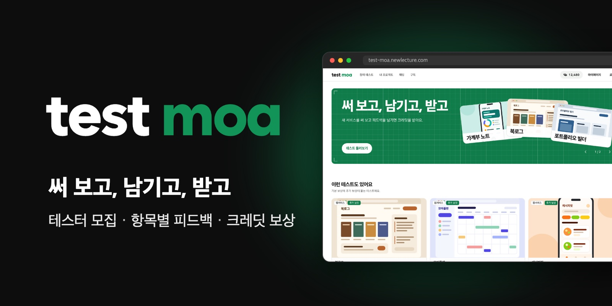

# test moa 설계 기록

소프트웨어 테스터 모집 플랫폼입니다. 개발자가 조건에 맞는 테스터를 모으고, 항목별 피드백을 받고, 크레딧으로 보상하는 서비스입니다. (5인 팀)

**역할**: 실시간 채팅 전체(설계·백엔드·화면 연결), 프론트 공통 구조, 테스트 서버 배포

## 고른 것과 버린 것

- **왜 SSE인가**: 메시지는 일반 POST로 보내고 서버는 "새 메시지·읽음" 알림만 보내면 돼서 WebSocket 대신 SSE를 골랐습니다. 일반 HTTP라 nginx → Next(BFF) → Spring 경로를 그대로 탈 수 있습니다.
- **일부러 하지 않은 것**: 채팅용 저장소를 따로 두지 않고 PostgreSQL에서 방 행 잠금과 방별 순번(`seq`)으로 순서·중복을 보장했습니다. Redis pub/sub은 서버가 한 대인 지금은 필요 없어 보류했습니다([#267](https://github.com/likelion-backendschool-9th/test-moa/issues/267)).

## 원인을 파고든 문제

- **CI에서만 실패한 채팅 테스트**: 테스트 컨텍스트 11개 × 커넥션 풀 10개 = 110개가 PostgreSQL 한도 100을 넘은 것이 원인이었습니다.
- **테스트 서버에서만 오지 않는 SSE**: 호스트 nginx의 버퍼링 때문이어서 SSE 경로에만 버퍼링 끔과 긴 read timeout을 따로 두었습니다.

## 기술

`Java 21` `Spring Boot 4.1` `Spring Security` `JPA` `PostgreSQL` `Next.js` `Docker` `GitHub Actions`

## 링크

[저장소](https://github.com/likelion-backendschool-9th/test-moa) · [테스트 서버](https://test-moa.newlecture.com) · [← 프로필로](../README.md)
